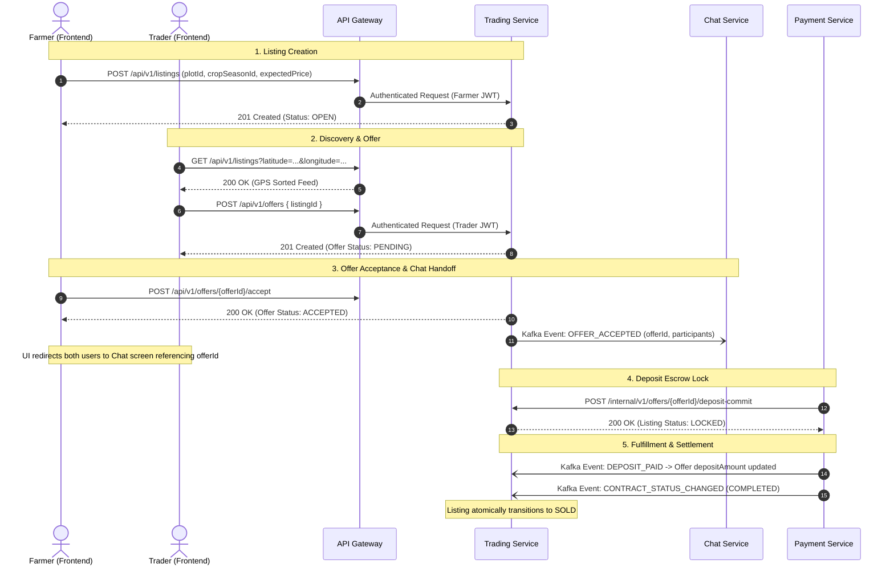

# Trading Service — Frontend Integration Contract & API Guide

> **Version:** 1.0.0  
> **Service:** `trading-service`  
> **Default Port:** `8083`  
> **API Gateway Port:** `8080` (routes `/api/v1/listings` and `/api/v1/offers`)  
> **Target Audience:** Frontend Web & Mobile Engineers  

---

## 1. System Overview & Architecture

The **Trading Service** is the marketplace engine of the Agriculture Management Platform. It enables:
1. **Farmers** to publish agricultural listings (crop produce) directly from their harvested plots and seasons.
2. **Traders** to browse the marketplace feed (with GPS distance calculation and sorting) and submit purchase offers.
3. **Farmers** to accept an offer, which automatically coordinates with the **Chat Service** for negotiation and the **Payment Service** for escrow deposit locking.
4. **Lifecycle tracking** from initial listing creation (`OPEN`), through deposit escrow commitment (`LOCKED`), to final fulfillment and sale (`SOLD`).

```
┌──────────────────────────────────────────────────────────────────────────────────┐
│                                 FRONTEND APPS                                    │
│                 (Web Portal / Mobile App - React / React Native)                 │
└────────────────────────────────────────┬─────────────────────────────────────────┘
                                         │  HTTP / REST (Bearer JWT)
                                         ▼
┌──────────────────────────────────────────────────────────────────────────────────┐
│                            API GATEWAY (Port: 8080)                              │
│                    Route: /api/v1/listings/** & /api/v1/offers/**                │
└────────────────────────────────────────┬─────────────────────────────────────────┘
                                         │  Forwarded Request
                                         ▼
┌──────────────────────────────────────────────────────────────────────────────────┐
│                          TRADING SERVICE (Port: 8083)                            │
│  ┌───────────────────────┐ ┌───────────────────────┐ ┌────────────────────────┐ │
│  │    Listing Hexagon    │ │     Offer Hexagon     │ │   Outbox & Consumers   │ │
│  └───────────┬───────────┘ └───────────┬───────────┘ └───────────┬────────────┘ │
└──────────────┼─────────────────────────┼─────────────────────────┼──────────────┘
               ▼                         ▼                         ▼
         [PostgreSQL DB]          [Kafka Broker]          [Farming & User RPC]
```

---

## 2. Environments & Base URLs

| Environment | Base URL via Gateway (Recommended) | Direct Service Base URL (Local Dev Only) |
|---|---|---|
| **Local Development** | `http://localhost:8080` | `http://localhost:8083` |
| **Docker Compose** | `http://api-gateway:8080` | `http://trading-service:8083` |
| **Staging / Production** | `https://api.agriplatform.com` | Internal Service Mesh only |

> [!IMPORTANT]
> Always route public requests through the **API Gateway** (`/api/v1/...`).  
> Internal routes starting with `/internal/v1/...` (e.g., `deposit-commit`) are exclusively for the Payment Service and will reject requests with `403 Forbidden` if called by frontend clients.

---

## 3. Authentication & Authorization

All public endpoints require authentication using a Bearer token issued by the **User Service**:

```http
Authorization: Bearer <ACCESS_TOKEN>
```

### 3.1 Token Details
- **Algorithm:** `RS256` asymmetric signature.
- **Roles:**
  - `FARMER`: Can create Listings, view Listings, view Offers made on their listings, and accept Offers.
  - `TRADER`: Can browse Listings, view Listing details, create Offers, and view their submitted Offers.
  - `ADMIN`: Has administrative read/access capabilities.

### 3.2 Implicit Identity Injection (Crucial Rule)
> [!WARNING]
> **Do NOT include `farmerId` or `traderId` in request bodies!**  
> The backend extracts the user's account ID directly from the validated JWT token (`sub` claim). This prevents identity spoofing and simplifies frontend form state.

### 3.3 Real-Time Account Status
Before processing any request, the backend verifies account standing in real-time. If the account status is `LOCKED`, `INACTIVE`, or `UNVERIFIED`, the API returns `403 Forbidden` with error code `ACCOUNT_NOT_ACTIVE`.

---

## 4. Data Types, Enums & Conventions

### 4.1 Enums

#### `ListingStatus`
| Status | Description | Frontend Action / UI State |
|---|---|---|
| `OPEN` | Available on marketplace. Accepting trader offers. | Show active "Make Offer" button for traders. |
| `LOCKED` | A deposit has been committed by a winning trader. | Show "Under Contract / Deposit Escrowed" badge. Disable new offers. |
| `SOLD` | Contract successfully delivered and completed. | Show "Completed / Sold" badge. Listing archived. |

#### `OfferStatus`
| Status | Description | Frontend Action / UI State |
|---|---|---|
| `PENDING` | Trader submitted offer; awaiting farmer review. | Farmer sees "Accept" button. Trader sees "Pending Review". |
| `ACCEPTED` | Farmer accepted the offer. Chat channel is now available. | Show "Open Chat" button linking to conversation. |

### 4.2 Monetary Values & Numbers
- **Monetary amounts** (`expectedPrice`, `depositAmount`) are represented as **positive decimal strings in VND** (e.g., `"4500000.00"`).
  - *Why:* Prevents JavaScript floating-point rounding errors (e.g., `0.1 + 0.2 !== 0.3`).
- **Quantities & Yields** (`estimatedYield`, `area`) are numbers representing kilograms (kg) and square meters ($m^2$).
- **Coordinates** (`latitude`, `longitude`) are numbers (e.g. `10.762622`, `106.660172`).
- **IDs**: All identifiers (`listingId`, `offerId`, `plotId`, `cropSeasonId`, etc.) are standard UUID strings.

---

## 5. Standard Response & Error Envelopes

### 5.1 Success Responses

#### Single Resource Queries / Actions (HTTP 200 OK)
Wrapped in a standard `{ data: T }` envelope:
```json
{
  "data": {
    "offerId": "0193132e-5000-7000-8000-000000000001",
    "listingId": "0193132e-4000-7000-8000-000000000002",
    "farmerId": "0193132e-1000-7000-8000-000000000003",
    "traderId": "0193132e-2000-7000-8000-000000000004",
    "depositAmount": "0.00",
    "status": "ACCEPTED",
    "createdAt": "2026-11-09T08:00:00.000Z",
    "updatedAt": "2026-11-09T08:15:00.000Z"
  }
}
```

#### Resource Creation (HTTP 201 Created)
Returns the created resource directly:
```json
{
  "listingId": "0193132e-4000-7000-8000-000000000002",
  "farmerId": "0193132e-1000-7000-8000-000000000003",
  "plotId": "0193132e-3000-7000-8000-000000000005",
  "cropSeasonId": "0193132e-3500-7000-8000-000000000006",
  "seedType": "ST25 Fragrant Rice",
  "estimatedYield": 5000,
  "area": 12000,
  "latitude": 10.762622,
  "longitude": 106.660172,
  "expectedPrice": "4500000.00",
  "status": "OPEN"
}
```

#### Paginated Feed Responses (HTTP 200 OK)
> [!NOTE]
> **Page indexing starts at `0`** (`page=0` is the 1st page, `page=1` is the 2nd page). Default `size` is `20`.

```json
{
  "items": [
    {
      "listingId": "0193132e-4000-7000-8000-000000000002",
      "farmerId": "0193132e-1000-7000-8000-000000000003",
      "plotId": "0193132e-3000-7000-8000-000000000005",
      "cropSeasonId": "0193132e-3500-7000-8000-000000000006",
      "seedType": "ST25 Fragrant Rice",
      "estimatedYield": 5000,
      "area": 12000,
      "latitude": 10.762622,
      "longitude": 106.660172,
      "expectedPrice": "4500000.00",
      "status": "OPEN"
    }
  ],
  "page": 0,
  "size": 20,
  "totalElements": 1,
  "totalPages": 1
}
```

### 5.2 Standard Error Response Envelope (BA-SOA §3)

All errors return a standardized format:

```json
{
  "timestamp": "2026-11-09T08:30:00.000Z",
  "status": 409,
  "code": "SNAPSHOT_INCOMPLETE",
  "message": "Crop snapshot is incomplete",
  "path": "/api/v1/listings",
  "details": {
    "cropType": "Crop type is missing in farming season"
  }
}
```

#### Error Code Reference Table

| HTTP Status | Error `code` | Meaning / Trigger Condition | Frontend Recommended Action |
|---|---|---|---|
| `400` | `VALIDATION_ERROR` | Request payload schema validation failed (e.g., malformed UUID or non-decimal price). | Inspect `details` object to mark invalid input fields. |
| `401` | `UNAUTHORIZED` | Bearer token is missing, expired, or invalid. | Redirect user to Login screen or refresh token. |
| `403` | `FORBIDDEN` | Caller does not possess the required role (e.g., Trader calling `acceptOffer`). | Show "Permission Denied" alert. |
| `403` | `ACCOUNT_NOT_ACTIVE` | User account is currently `LOCKED`, `INACTIVE`, or `UNVERIFIED`. | Show modal instructing user to verify account or contact support. |
| `404` | `NOT_FOUND` / `LISTING_NOT_FOUND` | Listing ID does not exist. | Display 404 Empty State / "Listing no longer exists". |
| `404` | `OFFER_NOT_FOUND` | Offer ID does not exist. | Display "Offer not found". |
| `409` | `SNAPSHOT_INCOMPLETE` | Plot has no harvest season, missing cropType, yield, or coordinates in Farming Service. | Inform farmer: "Please complete Plot harvest season details first". |
| `409` | `LISTING_NOT_OPEN` | Trader attempted to make an offer on a `LOCKED` or `SOLD` listing. | Notify trader: "This listing is no longer accepting offers". |
| `409` | `SELF_OFFER_NOT_ALLOWED` | Farmer attempted to submit an offer on their own listing. | Disable "Make Offer" button if `listing.farmerId === currentUserId`. |
| `409` | `LISTING_ALREADY_COMMITTED` | Listing was already committed to another winning deposit contract. | Inform trader: "Produce has already been committed to another buyer". |
| `503` | `DEPENDENCY_UNAVAILABLE` | Farming Service or dependent RPC is unreachable. | Show retry button: "Service temporarily unavailable, please retry". |
| `503` | `ACCESS_STATE_UNAVAILABLE` | Real-time auth state verification RPC timed out (1s fail-closed). | Prompt user to retry request. |

---

## 6. Detailed API Endpoints Reference

### 6.1 Listing APIs

#### 1. Create Listing
Creates a new marketplace listing from an existing Farming Plot and Harvest Season.

- **Method:** `POST`
- **Path:** `/api/v1/listings`
- **Auth:** `Bearer JWT` (Role: `FARMER`)
- **Request Headers:**
  ```http
  Authorization: Bearer <TOKEN>
  Content-Type: application/json
  ```
- **Request Body:**
  ```json
  {
    "plotId": "3fa85f64-5717-4562-b3fc-2c963f66afa6",
    "cropSeasonId": "7c9e6679-7425-40de-944b-e07fc1f90ae7",
    "expectedPrice": "4500000.00"
  }
  ```
  *(Note: `seedType`, `estimatedYield`, `area`, `latitude`, `longitude` are automatically fetched from the Farming Service snapshot by backend).*

- **Success Response (`201 Created`):**
  ```json
  {
    "listingId": "9b1deb4d-3b7d-4bad-9bdd-2b0d7b3dcb6d",
    "farmerId": "4a72d3e1-2f3b-48d6-95f3-f5c225381180",
    "plotId": "3fa85f64-5717-4562-b3fc-2c963f66afa6",
    "cropSeasonId": "7c9e6679-7425-40de-944b-e07fc1f90ae7",
    "seedType": "Jasmine Rice",
    "estimatedYield": 5000,
    "area": 10000,
    "latitude": 10.762622,
    "longitude": 106.660172,
    "expectedPrice": "4500000.00",
    "status": "OPEN"
  }
  ```

---

#### 2. Get Listing Feed (with GPS Sorting)
Returns a paginated list of marketplace listings. When user GPS coordinates (`latitude`, `longitude`) are supplied, the backend sorts listings by geographic proximity (nearest first).

- **Method:** `GET`
- **Path:** `/api/v1/listings`
- **Auth:** `Bearer JWT` (Any authenticated user)
- **Query Parameters:**
  | Param | Type | Required | Default | Description |
  |---|---|---|---|---|
  | `page` | Integer | No | `0` | Zero-indexed page number |
  | `size` | Integer | No | `20` | Page size (1 to 100) |
  | `status` | String | No | - | Filter by status: `OPEN`, `LOCKED`, `SOLD` |
  | `seedType` | String | No | - | Filter by crop/seed name (case-insensitive substring) |
  | `farmerId` | UUID | No | - | Filter by specific farmer |
  | `latitude` | Float | No | - | User GPS latitude (-90 to 90) for proximity sorting |
  | `longitude`| Float | No | - | User GPS longitude (-180 to 180) for proximity sorting |

- **Example Request:**
  ```http
  GET /api/v1/listings?page=0&size=10&status=OPEN&latitude=10.762622&longitude=106.660172
  ```

- **Success Response (`200 OK`):**
  ```json
  {
    "items": [
      {
        "listingId": "9b1deb4d-3b7d-4bad-9bdd-2b0d7b3dcb6d",
        "farmerId": "4a72d3e1-2f3b-48d6-95f3-f5c225381180",
        "plotId": "3fa85f64-5717-4562-b3fc-2c963f66afa6",
        "cropSeasonId": "7c9e6679-7425-40de-944b-e07fc1f90ae7",
        "seedType": "Jasmine Rice",
        "estimatedYield": 5000,
        "area": 10000,
        "latitude": 10.762622,
        "longitude": 106.660172,
        "expectedPrice": "4500000.00",
        "status": "OPEN"
      }
    ],
    "page": 0,
    "size": 10,
    "totalElements": 1,
    "totalPages": 1
  }
  ```

---

#### 3. Get Listing Detail
Returns complete information about a specific listing.

- **Method:** `GET`
- **Path:** `/api/v1/listings/:listingId`
- **Auth:** `Bearer JWT` (Any authenticated user)
- **Success Response (`200 OK`):**
  ```json
  {
    "data": {
      "listingId": "9b1deb4d-3b7d-4bad-9bdd-2b0d7b3dcb6d",
      "farmerId": "4a72d3e1-2f3b-48d6-95f3-f5c225381180",
      "plotId": "3fa85f64-5717-4562-b3fc-2c963f66afa6",
      "cropSeasonId": "7c9e6679-7425-40de-944b-e07fc1f90ae7",
      "seedType": "Jasmine Rice",
      "estimatedYield": 5000,
      "area": 10000,
      "latitude": 10.762622,
      "longitude": 106.660172,
      "expectedPrice": "4500000.00",
      "status": "OPEN"
    }
  }
  ```

---

### 6.2 Offer APIs

#### 4. Create Offer
A Trader creates an offer expressing interest to purchase produce from an `OPEN` listing.

- **Method:** `POST`
- **Path:** `/api/v1/offers`
- **Auth:** `Bearer JWT` (Role: `TRADER`)
- **Request Body:**
  ```json
  {
    "listingId": "9b1deb4d-3b7d-4bad-9bdd-2b0d7b3dcb6d"
  }
  ```
- **Business Rules:**
  - Listing must have status `OPEN`.
  - Caller cannot be the owner farmer (`SELF_OFFER_NOT_ALLOWED`).
- **Success Response (`201 Created`):**
  ```json
  {
    "offerId": "5f1a329d-ef81-4f1c-99f5-4f7f6a73c091",
    "listingId": "9b1deb4d-3b7d-4bad-9bdd-2b0d7b3dcb6d",
    "farmerId": "4a72d3e1-2f3b-48d6-95f3-f5c225381180",
    "traderId": "8b3f2c5d-91b4-4e78-9e54-5d9c223a7891",
    "depositAmount": "0.00",
    "status": "PENDING",
    "createdAt": "2026-11-09T08:35:00.000Z",
    "updatedAt": "2026-11-09T08:35:00.000Z"
  }
  ```

---

#### 5. Accept Offer
The owner Farmer accepts a pending offer. This triggers asynchronous events to open a **Chat conversation** between the farmer and trader.

- **Method:** `POST`
- **Path:** `/api/v1/offers/:offerId/accept`
- **Auth:** `Bearer JWT` (Role: `FARMER` — must be the owner of the listing)
- **Request Body:** None (empty object `{}` or no body)
- **Success Response (`200 OK`):**
  ```json
  {
    "data": {
      "offerId": "5f1a329d-ef81-4f1c-99f5-4f7f6a73c091",
      "listingId": "9b1deb4d-3b7d-4bad-9bdd-2b0d7b3dcb6d",
      "farmerId": "4a72d3e1-2f3b-48d6-95f3-f5c225381180",
      "traderId": "8b3f2c5d-91b4-4e78-9e54-5d9c223a7891",
      "depositAmount": "0.00",
      "status": "ACCEPTED",
      "createdAt": "2026-11-09T08:35:00.000Z",
      "updatedAt": "2026-11-09T08:40:00.000Z"
    }
  }
  ```

---

#### 6. Get Offer Detail
Fetch details of a specific offer.

- **Method:** `GET`
- **Path:** `/api/v1/offers/:offerId`
- **Auth:** `Bearer JWT` (Participant only — must be the offer's `farmerId`, `traderId`, or `ADMIN`)
- **Success Response (`200 OK`):**
  ```json
  {
    "data": {
      "offerId": "5f1a329d-ef81-4f1c-99f5-4f7f6a73c091",
      "listingId": "9b1deb4d-3b7d-4bad-9bdd-2b0d7b3dcb6d",
      "farmerId": "4a72d3e1-2f3b-48d6-95f3-f5c225381180",
      "traderId": "8b3f2c5d-91b4-4e78-9e54-5d9c223a7891",
      "depositAmount": "250000.00",
      "status": "ACCEPTED",
      "createdAt": "2026-11-09T08:35:00.000Z",
      "updatedAt": "2026-11-09T08:40:00.000Z"
    }
  }
  ```

---

#### 7. List Offers
Fetch paginated offers. Scoped automatically to relevant offers.

- **Method:** `GET`
- **Path:** `/api/v1/offers`
- **Auth:** `Bearer JWT` (Any authenticated participant)
- **Query Parameters:**
  | Param | Type | Required | Description |
  |---|---|---|---|
  | `page` | Integer | No (Default `0`) | 0-indexed page |
  | `size` | Integer | No (Default `20`) | Page limit (max 100) |
  | `listingId` | UUID | No | Filter offers for a specific listing |
  | `status` | String | No | Filter by `PENDING` or `ACCEPTED` |
  | `farmerId` | UUID | No | Filter by farmer |
  | `traderId` | UUID | No | Filter by trader |

- **Success Response (`200 OK`):**
  ```json
  {
    "items": [
      {
        "offerId": "5f1a329d-ef81-4f1c-99f5-4f7f6a73c091",
        "listingId": "9b1deb4d-3b7d-4bad-9bdd-2b0d7b3dcb6d",
        "farmerId": "4a72d3e1-2f3b-48d6-95f3-f5c225381180",
        "traderId": "8b3f2c5d-91b4-4e78-9e54-5d9c223a7891",
        "depositAmount": "0.00",
        "status": "PENDING",
        "createdAt": "2026-11-09T08:35:00.000Z",
        "updatedAt": "2026-11-09T08:35:00.000Z"
      }
    ],
    "page": 0,
    "size": 20,
    "totalElements": 1,
    "totalPages": 1
  }
  ```

---

## 7. End-to-End User Journeys (Frontend UI Flows)



---

## 8. Frontend TypeScript Definitions

Copy-paste these types directly into your frontend codebase (e.g., `src/types/trading.ts`):

```typescript
// ─── Enums ────────────────────────────────────────────────────────

export type ListingStatus = "OPEN" | "LOCKED" | "SOLD";
export type OfferStatus = "PENDING" | "ACCEPTED";

// ─── Listing Types ────────────────────────────────────────────────

export interface CreateListingRequest {
  plotId: string;        // UUID
  cropSeasonId: string;  // UUID
  expectedPrice: string; // Positive decimal string in VND, e.g. "4500000.00"
}

export interface ListingDTO {
  listingId: string;
  farmerId: string;
  plotId: string;
  cropSeasonId: string;
  seedType: string;
  estimatedYield: number; // in kg
  area: number;           // in m²
  latitude: number;
  longitude: number;
  expectedPrice: string;  // in VND (decimal string)
  status: ListingStatus;
}

export interface ListingFilterQuery {
  page?: number;          // 0-indexed (default: 0)
  size?: number;          // default: 20, max: 100
  status?: ListingStatus;
  seedType?: string;
  farmerId?: string;
  latitude?: number;      // -90 to 90 for GPS proximity
  longitude?: number;     // -180 to 180 for GPS proximity
}

// ─── Offer Types ──────────────────────────────────────────────────

export interface CreateOfferRequest {
  listingId: string;      // UUID
}

export interface OfferDTO {
  offerId: string;
  listingId: string;
  farmerId: string;
  traderId: string;
  depositAmount: string;  // in VND, e.g. "0.00" or "250000.00"
  status: OfferStatus;
  createdAt: string;      // ISO 8601
  updatedAt: string;      // ISO 8601
}

export interface OfferFilterQuery {
  page?: number;
  size?: number;
  listingId?: string;
  status?: OfferStatus;
  farmerId?: string;
  traderId?: string;
}

// ─── API Envelope Types ───────────────────────────────────────────

export interface SingleResponse<T> {
  data: T;
}

export interface PagedResponse<T> {
  items: T[];
  page: number;
  size: number;
  totalElements: number;
  totalPages: number;
}

export interface ApiErrorResponse {
  timestamp: string;
  status: number;
  code: string;
  message: string;
  path: string;
  details?: Record<string, string>;
}
```

---

## 9. Ready-to-Use Frontend Integration Snippets

### 9.1 Axios Client with Auto-Injected Bearer Token

```typescript
// src/api/apiClient.ts
import axios from "axios";

export const apiClient = axios.create({
  baseURL: process.env.REACT_APP_API_GATEWAY_URL || "http://localhost:8080/api/v1",
  headers: {
    "Content-Type": "application/json",
  },
});

// Attach Bearer token from local storage or auth store
apiClient.interceptors.request.use((config) => {
  const token = localStorage.getItem("accessToken");
  if (token) {
    config.headers.Authorization = `Bearer ${token}`;
  }
  return config;
});
```

### 9.2 API Service Functions

```typescript
// src/api/tradingService.ts
import { apiClient } from "./apiClient";
import {
  CreateListingRequest,
  CreateOfferRequest,
  ListingDTO,
  ListingFilterQuery,
  OfferDTO,
  OfferFilterQuery,
  PagedResponse,
  SingleResponse,
} from "../types/trading";

export const tradingApi = {
  // ── Listings ──
  createListing: async (payload: CreateListingRequest): Promise<ListingDTO> => {
    const res = await apiClient.post<ListingDTO>("/listings", payload);
    return res.data;
  },

  getListingsFeed: async (params?: ListingFilterQuery): Promise<PagedResponse<ListingDTO>> => {
    const res = await apiClient.get<PagedResponse<ListingDTO>>("/listings", { params });
    return res.data;
  },

  getListingDetail: async (listingId: string): Promise<ListingDTO> => {
    const res = await apiClient.get<SingleResponse<ListingDTO>>(`/listings/${listingId}`);
    return res.data.data;
  },

  // ── Offers ──
  createOffer: async (payload: CreateOfferRequest): Promise<OfferDTO> => {
    const res = await apiClient.post<OfferDTO>("/offers", payload);
    return res.data;
  },

  acceptOffer: async (offerId: string): Promise<OfferDTO> => {
    const res = await apiClient.post<SingleResponse<OfferDTO>>(`/offers/${offerId}/accept`);
    return res.data.data;
  },

  getOfferDetail: async (offerId: string): Promise<OfferDTO> => {
    const res = await apiClient.get<SingleResponse<OfferDTO>>(`/offers/${offerId}`);
    return res.data.data;
  },

  listOffers: async (params?: OfferFilterQuery): Promise<PagedResponse<OfferDTO>> => {
    const res = await apiClient.get<PagedResponse<OfferDTO>>("/offers", { params });
    return res.data;
  },
};
```

### 9.3 Display Formatters

```typescript
// src/utils/formatters.ts

/**
 * Format string decimal VND currency to localized string: "4.500.000 ₫"
 */
export function formatVND(amountStr: string | number): string {
  const num = typeof amountStr === "string" ? parseFloat(amountStr) : amountStr;
  if (isNaN(num)) return "0 ₫";
  return new Intl.NumberFormat("vi-VN", {
    style: "currency",
    currency: "VND",
  }).format(num);
}

/**
 * Format weight in kilograms to Metric Tons or kg
 */
export function formatYield(kg: number): string {
  if (kg >= 1000) {
    return `${(kg / 1000).toLocaleString("vi-VN", { maximumFractionDigits: 1 })} tấn`;
  }
  return `${kg.toLocaleString("vi-VN")} kg`;
}
```

---

## 10. Frequently Asked Questions (FAQ)

**Q1: How do I know if an offer is already accepted?**  
`offer.status === "ACCEPTED"`. Once accepted, you should render an "Open Chat" action button that navigates the user to `/chat?offerId=${offer.offerId}`.

**Q2: Can a trader submit an offer on a `LOCKED` listing?**  
No. The backend will reject the request with `409 Conflict` (`LISTING_NOT_OPEN`). Disable the "Make Offer" button in the UI if `listing.status !== 'OPEN'`.

**Q3: Can a farmer create an offer on their own listing?**  
No. The backend returns `409 Conflict` (`SELF_OFFER_NOT_ALLOWED`). In the UI, hide or disable the "Make Offer" button if `listing.farmerId === currentUser.sub`.

**Q4: How should pagination UI be built?**  
The API is 0-indexed (`page=0` is the first page). When building UI pagination controls:
- First page: query `page=0`.
- Next page: increment current page number by 1 up to `totalPages - 1`.
- Has next page condition: `page + 1 < totalPages`.

**Q5: When does a listing become `SOLD`?**  
The listing automatically transitions to `SOLD` via a Kafka event (`CONTRACT_STATUS_CHANGED` with `COMPLETED`) once delivery and final contract payment are settled. When the listing is `SOLD`, frontend UI should treat it as historical/archived.

