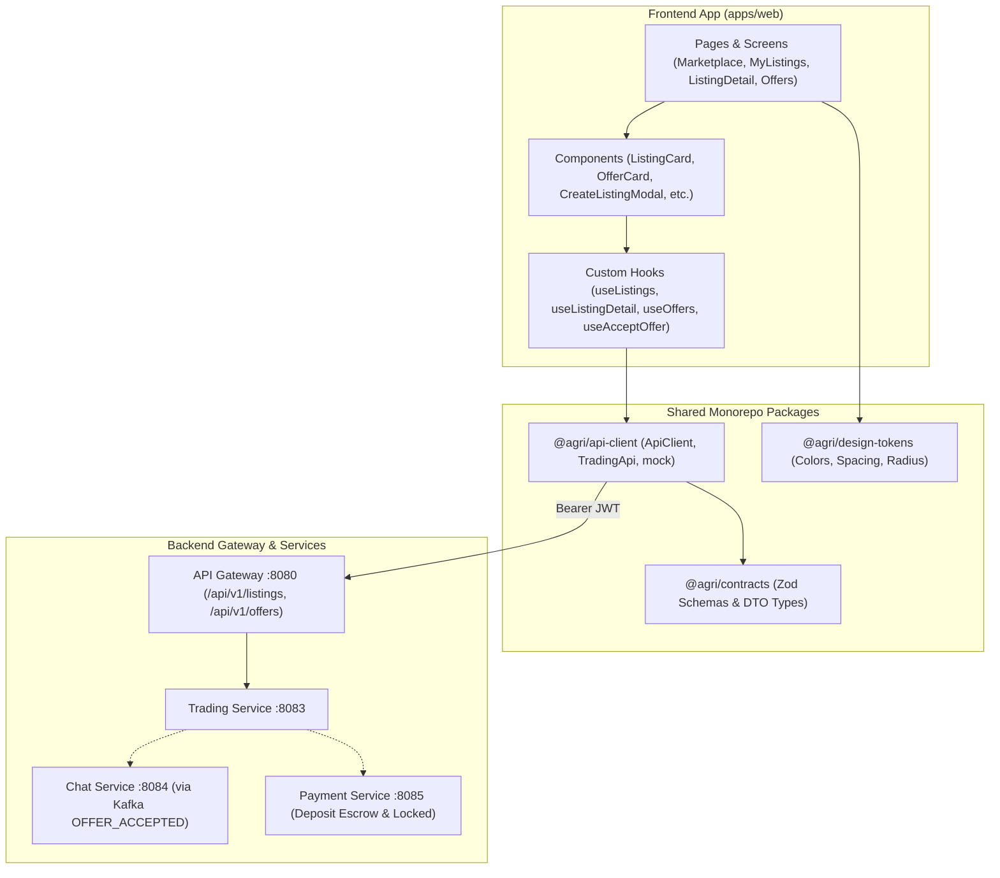

# Trading Frontend Implementation Plan (Finalized & Confirmed with contract.md)

> [!NOTE]
> **Project**: Ruộng Lúa Việt — Agricultural Marketplace connecting Farmers and Traders.  
> **Source Contract**: `contract.md` (v1.0.0, Service `trading-service`, Port 8083 via Gateway 8080).  
> **Stack**: React 19 + Vite 8, TanStack Query 5, Zod 3, TypeScript 6, monorepo with `packages/` (`contracts`, `api-client`, `design-tokens`) + `apps/web/`.  
> **Reference Pattern**: `features/users/` (`AuthPage.tsx`, `auth.css`, `GoogleSignIn.tsx`).

---

## 1. Contract Confirmation & Architectural Findings

With the release of **`contract.md`**, all previous uncertainties and pending questions from `docs/09` and `01-trading-service.md` are **100% resolved and confirmed**:

| Previous Ambiguity | Confirmed by `contract.md` | Implementation Details |
|---|---|---|
| **Marketplace Feed vs Listing List** | Unified into `GET /api/v1/listings` | Supports query params: `page`, `size`, `status`, `seedType`, `farmerId`, `latitude`, `longitude`. Proximity sorting occurs on backend when `latitude` + `longitude` are passed. |
| **My Listings Endpoint** | `GET /api/v1/listings?farmerId={farmerId}` | Role `FARMER`: fetch own listings filtered by `farmerId` extracted from JWT `sub`. |
| **Listing Detail Endpoint** | `GET /api/v1/listings/:listingId` | Returns `{ data: ListingDTO }` single-resource envelope. |
| **Create Listing Request & Response** | `POST /api/v1/listings` | Request: `{ plotId, cropSeasonId, expectedPrice }`. 201 Created returns `ListingDTO` directly. No `farmerId` in body (injected from JWT). |
| **Create Offer Request** | `POST /api/v1/offers` | Request: `{ listingId }` (UUID). Trader expresses interest. 201 Created returns `OfferDTO` directly (`depositAmount: "0.00"`, `status: "PENDING"`). |
| **Accept Offer Method & Body** | `POST /api/v1/offers/:offerId/accept` | `POST` method (not PUT), empty body `{}`. Returns `{ data: OfferDTO }` with `status: "ACCEPTED"`. Emits Kafka event to open Chat. |
| **List Offers (My Offers & Listing Offers)** | `GET /api/v1/offers` | Supports query params: `page`, `size`, `listingId`, `status`, `farmerId`, `traderId`. Returns `{ items: OfferDTO[], page, size, totalElements, totalPages }`. |
| **Get Offer Detail** | `GET /api/v1/offers/:offerId` | Returns `{ data: OfferDTO }`. Accessible by participants (`farmerId`, `traderId`, `ADMIN`). |
| **Currency & Monetary Amounts** | Positive decimal string in VND | Format: `/^\d+(\.\d{2})?$/` (e.g. `"4500000.00"`). Display formatted via `formatVND` utility. |
| **Pagination Scheme** | Zero-indexed page-based | `{ items: T[], page: 0, size: 20, totalElements, totalPages }`. |
| **Envelopes** | Single vs List separation | Single resource: `{ data: T }`. List: `{ items: T[], page, size, totalElements, totalPages }`. Creation: direct resource. |

---

## 2. Architecture & Data Flow



---

## 3. Confirmed Data Schemas & Contracts (`@agri/contracts`)

### 3.1 Enums
- **`ListingStatus`**: `'OPEN' | 'LOCKED' | 'SOLD'`
- **`OfferStatus`**: `'PENDING' | 'ACCEPTED'`

### 3.2 Listing Schemas
```typescript
// Listing DTO (used in feed items, create response, and detail data)
export const listingDtoSchema = z.object({
  listingId: z.string().uuid(),
  farmerId: z.string().uuid(),
  plotId: z.string().uuid(),
  cropSeasonId: z.string().uuid(),
  seedType: z.string().min(1),
  estimatedYield: z.number().nonnegative(), // in kg
  area: z.number().positive(),              // in m²
  latitude: z.number().min(-90).max(90),
  longitude: z.number().min(-180).max(180),
  expectedPrice: z.string().regex(/^\d+(\.\d{2})?$/, 'Giá phải là decimal string VND'),
  status: z.enum(['OPEN', 'LOCKED', 'SOLD']),
});
export type ListingDTO = z.infer<typeof listingDtoSchema>;

// Request: POST /api/v1/listings
export const createListingRequestSchema = z.object({
  plotId: z.string().uuid(),
  cropSeasonId: z.string().uuid(),
  expectedPrice: z.string().regex(/^\d+(\.\d{2})?$/, 'Giá phải là decimal string VND'),
});
export type CreateListingRequest = z.infer<typeof createListingRequestSchema>;

// Query: GET /api/v1/listings
export const listingFilterQuerySchema = z.object({
  page: z.number().int().nonnegative().default(0),
  size: z.number().int().min(1).max(100).default(20),
  status: z.enum(['OPEN', 'LOCKED', 'SOLD']).optional(),
  seedType: z.string().optional(),
  farmerId: z.string().uuid().optional(),
  latitude: z.number().min(-90).max(90).optional(),
  longitude: z.number().min(-180).max(180).optional(),
});
export type ListingFilterQuery = z.infer<typeof listingFilterQuerySchema>;
```

### 3.3 Offer Schemas
```typescript
// Offer DTO
export const offerDtoSchema = z.object({
  offerId: z.string().uuid(),
  listingId: z.string().uuid(),
  farmerId: z.string().uuid(),
  traderId: z.string().uuid(),
  depositAmount: z.string().regex(/^\d+(\.\d{2})?$/), // in VND (starts at "0.00")
  status: z.enum(['PENDING', 'ACCEPTED']),
  createdAt: z.string(),
  updatedAt: z.string(),
});
export type OfferDTO = z.infer<typeof offerDtoSchema>;

// Request: POST /api/v1/offers
export const createOfferRequestSchema = z.object({
  listingId: z.string().uuid(),
});
export type CreateOfferRequest = z.infer<typeof createOfferRequestSchema>;

// Query: GET /api/v1/offers
export const offerFilterQuerySchema = z.object({
  page: z.number().int().nonnegative().default(0),
  size: z.number().int().min(1).max(100).default(20),
  listingId: z.string().uuid().optional(),
  status: z.enum(['PENDING', 'ACCEPTED']).optional(),
  farmerId: z.string().uuid().optional(),
  traderId: z.string().uuid().optional(),
});
export type OfferFilterQuery = z.infer<typeof offerFilterQuerySchema>;
```

### 3.4 Envelope Schemas
```typescript
// Single resource wrapper: { data: T }
export const singleResponseSchema = <T extends z.ZodTypeAny>(dataSchema: T) =>
  z.object({ data: dataSchema });
export type SingleResponse<T> = { data: T };

// Paginated items wrapper: { items: T[], page, size, totalElements, totalPages }
export const pagedListingSchema = pageSchema(listingDtoSchema);
export const pagedOfferSchema = pageSchema(offerDtoSchema);
```

---

## 4. API Client Interface (`@agri/api-client`)

`packages/api-client/src/trading.ts` will provide:

```typescript
export interface TradingApi {
  // ── Listings ──
  createListing(payload: CreateListingRequest, idempotencyKey?: string, signal?: AbortSignal): Promise<ListingDTO>;
  getListings(params?: ListingFilterQuery, signal?: AbortSignal): Promise<Page<ListingDTO>>;
  getListingDetail(listingId: string, signal?: AbortSignal): Promise<ListingDTO>;

  // ── Offers ──
  createOffer(payload: CreateOfferRequest, idempotencyKey?: string, signal?: AbortSignal): Promise<OfferDTO>;
  acceptOffer(offerId: string, signal?: AbortSignal): Promise<OfferDTO>;
  getOfferDetail(offerId: string, signal?: AbortSignal): Promise<OfferDTO>;
  listOffers(params?: OfferFilterQuery, signal?: AbortSignal): Promise<Page<OfferDTO>>;
}
```

---

## 5. Implementation Breakdown — 5 Actionable Phases

### Phase 1: Contracts, API Client & Mock Updates
**Target Files**:
- `packages/contracts/src/trading.ts` & `index.ts`
- `packages/api-client/src/trading.ts`
- `packages/api-client/src/mock.ts`
- `packages/api-client/src/trading.test.ts`

**Work Items**:
1. Implement full Zod schemas (`listingDtoSchema`, `createListingRequestSchema`, `listingFilterQuerySchema`, `offerDtoSchema`, `createOfferRequestSchema`, `offerFilterQuerySchema`, `singleResponseSchema`).
2. Update `createTradingApi` to implement all 7 endpoints with proper URLs, query serialization, request envelopes, and schema validation.
3. Update `mockTradingApi` to support all listing queries (GPS proximity sorting, status/farmer filter), detail fetch, offer creation, offer listing, and offer acceptance.
4. Add unit test suite verifying:
   - `createListing` 201 direct schema response.
   - `getListings` pagination + GPS query parameters.
   - `getListingDetail` `{ data }` unwrapping.
   - `createOffer` validation & 201 response.
   - `acceptOffer` status transition to `ACCEPTED`.
   - `listOffers` filtering by `listingId`, `farmerId`, `traderId`.

---

### Phase 2: Shell Layout, Routing & Authentication Guards
**Target Files**:
- `apps/web/src/shared/layouts/WebLayout.tsx` & `web-layout.css`
- `apps/web/src/shared/hooks/useAuth.ts`
- `apps/web/src/shared/utils/formatters.ts` (currency & yield formatters)
- `apps/web/src/app/App.tsx`

**Work Items**:
1. **`useAuth` hook**:
   - `useSession()` — reactive session state via `useSyncExternalStore`.
   - `useRequireAuth()` — redirect unauthenticated visitors to `/dang-nhap`.
   - `useRole()` — current role (`FARMER`, `TRADER`, `ADMIN`).
   - Role-based route guard component `<RoleGuard allowedRoles={['...']} />`.
2. **`WebLayout`**:
   - Sidebar navigation generated dynamically from `modules.ts` filtered by `session.role`.
   - Top navigation bar showing user identity, role badge, and "Đăng xuất" action.
   - Main content viewport with responsive container.
3. **`formatters.ts`**:
   - `formatVND(value: string | number)` → `"4.500.000 ₫"`.
   - `formatYield(kg: number)` → `"5 tấn"` or `"500 kg"`.
   - `formatArea(m2: number)` → `"10.000 m²"`.
4. **`App.tsx` Routing**:
   ```
   /dang-nhap, /dang-ky (public auth)
   / (protected under WebLayout)
     ├── /thi-truong                  → MarketplacePage (TRADER, ADMIN)
     ├── /bai-dang                    → MyListingsPage (FARMER)
     ├── /bai-dang/tao-moi            → CreateListingPage (FARMER)
     ├── /bai-dang/:listingId         → ListingDetailPage (All roles)
     ├── /bai-dang/:listingId/bao-gia → ListingOffersPage (FARMER)
     ├── /bao-gia                     → MyOffersPage (TRADER)
     └── /chat?offerId=...            → Placeholder/redirect to chat
   ```

---

### Phase 3: Marketplace (Trader Discovery with GPS Proximity)
**Target Files**:
- `apps/web/src/features/trading/hooks/useListings.ts`
- `apps/web/src/features/trading/components/ListingCard.tsx`
- `apps/web/src/features/trading/pages/MarketplacePage.tsx`
- `apps/web/src/features/trading/pages/marketplace.css`

**Work Items**:
1. **`useListings` Hook**:
   - TanStack Query hook calling `tradingApi.getListings({ page, size, status: 'OPEN', seedType, latitude, longitude })`.
   - Browser Geolocation API integration (retrieves latitude & longitude with user consent, cached in session).
2. **`ListingCard` Component**:
   - Produce badge (Seed type e.g. "Gạo ST25"), status badge ("Đang mở").
   - Yield & area metrics (`5 tấn` · `10.000 m²`).
   - Expected price highlighted (`4.500.000 ₫`).
   - Location coordinates and GPS distance indicator (if coordinates available).
   - "Xem chi tiết" / "Gửi báo giá" action buttons.
3. **`MarketplacePage`**:
   - Search bar for `seedType`.
   - GPS permission banner / toggle for proximity sorting.
   - Grid layout of `ListingCard` with loading skeletons and empty state ("Không tìm thấy bài đăng nào").
   - 0-indexed pagination controls (Trang trước / Trang sau / Tổng số).

---

### Phase 4: Farmer Produce Publishing (Create Listing & My Listings)
**Target Files**:
- `apps/web/src/features/trading/hooks/useCreateListing.ts`
- `apps/web/src/features/trading/components/CreateListingForm.tsx`
- `apps/web/src/features/trading/pages/CreateListingPage.tsx`
- `apps/web/src/features/trading/pages/MyListingsPage.tsx`
- `apps/web/src/features/trading/pages/ListingDetailPage.tsx`
- `apps/web/src/features/trading/pages/trading.css`

**Work Items**:
1. **`useCreateListing` Hook**:
   - `useMutation` calling `tradingApi.createListing(payload, idempotencyKey)`.
   - Automatic Idempotency Key header generation (`crypto.randomUUID()`).
   - Error mapping:
     - `409 SNAPSHOT_INCOMPLETE`: "Mùa vụ canh tác chưa hoàn thiện thông tin (sản lượng/giống/tọa độ). Vui lòng cập nhật mục Ruộng & Mùa vụ trước."
     - `400 VALIDATION_ERROR`: displays specific field validation issues.
     - `503 DEPENDENCY_UNAVAILABLE`: "Dịch vụ canh tác tạm thời không phản hồi. Vui lòng thử lại sau."
2. **`CreateListingPage` & `CreateListingForm`**:
   - Inputs for `plotId` and `cropSeasonId` (validated UUID format, with guidance).
   - Input for `expectedPrice` with live formatted preview ("4.500.000 ₫").
   - Submitting button with spinner and single-click protection (`disabled={isPending}`).
3. **`MyListingsPage`**:
   - Query: `tradingApi.getListings({ farmerId: currentUserId })`.
   - Tab / filter by status (`ALL`, `OPEN`, `LOCKED`, `SOLD`).
   - Table or card view showing listing details, offers count link, and status badge.
4. **`ListingDetailPage`**:
   - Query: `tradingApi.getListingDetail(listingId)`.
   - Full specification display: seed type, estimated yield, land area, expected price, GPS location map preview.
   - Dynamic CTA:
     - If current user is owner Farmer: show "Danh sách báo giá đã nhận" button.
     - If current user is Trader and status is `OPEN`: show "Gửi báo giá" (Create Offer) button.
     - If `LOCKED`: display "Đã cọc — Đang thực hiện hợp đồng".
     - If `SOLD`: display "Đã hoàn thành giao dịch".

---

### Phase 5: Offer Negotiations & Acceptance Flow
**Target Files**:
- `apps/web/src/features/trading/hooks/useOffers.ts`
- `apps/web/src/features/trading/components/OfferCard.tsx`
- `apps/web/src/features/trading/pages/ListingOffersPage.tsx`
- `apps/web/src/features/trading/pages/MyOffersPage.tsx`

**Work Items**:
1. **Offer Creation Modal / Action**:
   - Trader triggers "Gửi báo giá" on an OPEN listing.
   - Direct confirmation dialog: "Gửi báo giá quan tâm mua sản phẩm này?".
   - On submit: `tradingApi.createOffer({ listingId })`.
   - Error handling: `409 SELF_OFFER_NOT_ALLOWED` ("Bạn không thể gửi báo giá cho bài đăng của chính mình"), `409 LISTING_NOT_OPEN`.
2. **`ListingOffersPage` (Farmer review)**:
   - Query: `tradingApi.listOffers({ listingId })`.
   - Renders received offers list with trader info, created date, and status.
   - "Chấp nhận báo giá" (`acceptOffer`) action:
     - Calls `POST /api/v1/offers/:offerId/accept`.
     - Confirmation modal explaining: "Chấp nhận báo giá sẽ tự động mở phòng hội thoại thương lượng với thương lái."
     - On success: show success notification + "Đến phòng chat" action linking to `/chat?offerId={offerId}`.
3. **`MyOffersPage` (Trader history)**:
   - Query: `tradingApi.listOffers({ traderId: currentUserId })`.
   - Status badge: `PENDING` (Đang chờ phản hồi), `ACCEPTED` (Đã được duyệt — Mở Chat).
   - Direct link to listing detail and chat.

---

## 6. Complete File Structure to Implement

```
frontend-standard/
├── packages/
│   ├── contracts/src/
│   │   ├── trading.ts               <-- Updated full schemas & types matching contract.md
│   │   └── index.ts
│   └── api-client/src/
│       ├── trading.ts               <-- Complete 7 endpoints implementation
│       ├── mock.ts                  <-- Mock data & behavior for all 7 endpoints
│       └── trading.test.ts          <-- Full test suite for trading APIs
└── apps/web/src/
    ├── app/
    │   └── App.tsx                  <-- Routing with WebLayout & role guards
    ├── shared/
    │   ├── layouts/
    │   │   ├── WebLayout.tsx        <-- Sidebar + Header responsive layout
    │   │   └── web-layout.css
    │   ├── hooks/
    │   │   └── useAuth.ts           <-- useSession, useRole, useRequireAuth
    │   └── utils/
    │       └── formatters.ts        <-- formatVND, formatYield, formatArea
    └── features/trading/
        ├── components/
        │   ├── ListingCard.tsx      <-- Produce listing card
        │   ├── OfferCard.tsx        <-- Offer review card
        │   ├── CreateListingForm.tsx<-- Produce listing form
        │   └── MakeOfferModal.tsx   <-- Quick offer submission modal
        ├── hooks/
        │   ├── useListings.ts       <-- Feed & MyListings queries
        │   ├── useListingDetail.ts  <-- Detail query
        │   ├── useCreateListing.ts  <-- Listing creation mutation
        │   └── useOffers.ts         <-- Offer list, create & accept mutations
        └── pages/
            ├── MarketplacePage.tsx  <-- Trader marketplace with GPS
            ├── CreateListingPage.tsx<-- Farmer post listing page
            ├── MyListingsPage.tsx   <-- Farmer listings management
            ├── ListingDetailPage.tsx<-- Single listing detail view
            ├── ListingOffersPage.tsx<-- Offers received on a listing
            ├── MyOffersPage.tsx     <-- Trader submitted offers
            ├── marketplace.css
            └── trading.css
```

---

## 7. Immediate Next Step

With all endpoints and contracts officially confirmed by `contract.md`:
1. Start **Phase 1**: Update `packages/contracts/src/trading.ts`, `packages/api-client/src/trading.ts`, `mock.ts`, and run `trading.test.ts` to ensure 100% green test coverage.
2. Proceed to **Phase 2**: Scaffold `WebLayout.tsx`, `useAuth.ts`, `formatters.ts`, and wire the routes in `App.tsx`.
3. Build the UI pages in **Phases 3, 4, 5**.
